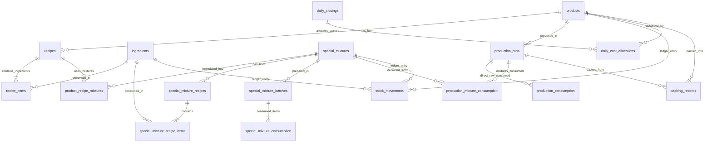

# Pulari Bakes Production Management System
## Database Portability, Migration & Zero Vendor Lock-in Architecture (Section 13)

---

## 1. Executive Summary & Architectural Goals

The **Pulari Bakes Production Management System** is architected to guarantee **100% database portability and zero vendor lock-in**. 

While the system is currently hosted on **Supabase Free Tier** (`https://dlqnmjmomhxavdkttltg.supabase.co`), the entire database, stored procedures, triggers, calculations, and frontends are decoupled from proprietary Supabase vendor features.

The application can be seamlessly migrated at any time to:
1. **Another Supabase project** (e.g., dedicated organization or upgraded plan).
2. **Self-hosted PostgreSQL 14 / 15 / 16** via Docker or bare-metal Linux VPS.
3. **Managed Cloud PostgreSQL** (Neon, AWS RDS, DigitalOcean Managed PostgreSQL, Google Cloud SQL, Aiven).
4. **PostgREST-powered custom backend** without modifying application business logic or frontend code.

---

## 2. Complete Database Schema & Architectural Overview

The database is built on **standard ANSI SQL / PostgreSQL 14+** using the `public` schema. All IDs utilize standard `UUID` v4 (`gen_random_uuid()` / `uuid-ossp`). Precise monetary values use `NUMERIC(12, 2)` or `NUMERIC(14, 2)`, while stock quantities use `NUMERIC(12, 3)` (milligram/gram precision).

### Summary Table Matrix (27 Core Portable Tables)

| Domain | Table Name | Purpose | Primary Keys & Foreign Keys |
| :--- | :--- | :--- | :--- |
| **Catalogues** | `products` | Finished goods catalogue (Snacks, Cakes) | `id (PK)`, `recipe_id (FK -> recipes.id)` |
| | `ingredients` | Raw materials catalogue (Flour, Sugar, Dal, Oil) | `id (PK)`, Category (`basic` \| `other`) |
| | `packet_types` | Packing pouch sizes & bundle costs | `id (PK)` |
| | `unit_conversions`| Cross-unit conversion rates (g <-> kg, ml <-> L) | `id (PK)`, `UNIQUE(from_unit, to_unit)` |
| **Formulations (BOM)** | `recipes` | Master Bill of Materials for products | `id (PK)`, `product_id (FK -> products.id)` |
| | `recipe_items` | Raw ingredients required per recipe batch | `id (PK)`, `recipe_id (FK)`, `ingredient_id (FK)` |
| | `recipe_packets` | Packaging specs for product recipes | `id (PK)`, `recipe_id (FK)`, `packet_type_id (FK)` |
| **Special Mixtures** | `special_mixtures` | Intermediate cooked mixtures (Whipping cream, Plum mixture) | `id (PK)`, `name (UNIQUE)` |
| | `special_mixture_recipes` | BOM recipes for preparing intermediate mixtures | `id (PK)`, `mixture_id (FK -> special_mixtures.id)` |
| | `special_mixture_recipe_items` | Ingredients required per mixture recipe | `id (PK)`, `mixture_recipe_id (FK)`, `ingredient_id (FK)` |
| | `special_mixture_batches` | Executed batch preparations of mixtures | `id (PK)`, `mixture_id (FK)` |
| | `special_mixture_consumption` | Actual ingredients consumed per mixture batch | `id (PK)`, `batch_id (FK)`, `ingredient_id (FK)` |
| | `product_recipe_mixtures` | Mixture requirements in final product recipes | `id (PK)`, `recipe_id (FK)`, `mixture_id (FK)` |
| | `production_mixture_consumption` | Mixture quantities consumed in cake production | `id (PK)`, `production_run_id (FK)`, `mixture_id (FK)` |
| **Production** | `production_runs` | Finished batch production records | `id (PK)`, `product_id (FK)`, `recipe_id (FK)` |
| | `production_consumption` | Direct raw ingredients consumed in batch | `id (PK)`, `run_id (FK)`, `ingredient_id (FK)` |
| **Inventory Ledger** | `stock_movements` | Immutable double-entry stock transaction ledger | `id (PK)`, `item_id (UUID)`, `item_type (TEXT)` |
| | `daily_closings` | End-of-day oil balance & daily wage closing | `id (PK)`, `production_date (DATE UNIQUE)` |
| | `daily_cost_allocations` | Weighted shared expense distribution per product | `id (PK)`, `daily_closing_id (FK)`, `product_id (FK)` |
| **Packaging & Sales** | `packing_records` | Packets packed, covers consumed & packing labour | `id (PK)`, `product_id (FK)`, `production_run_id (FK)` |
| | `packaging_items` | Cover costs per product packet size | `id (PK)`, `product_id (FK)` |
| | `daily_wages` | Daily wage breakdown (Cooking vs Packing labour) | `id (PK)`, `date (DATE)` |
| | `product_selling_prices`| Wholesale & retail selling prices by size | `id (PK)`, `product_id (FK)` |
| | `sales` | Sales dispatch records & revenue | `id (PK)`, `product_id (FK)` |
| **Security & Audits**| `admin_security` | Offline-first PIN hash & salt (bcrypt/pgcrypto) | `id (PK)` (Single active row) |
| | `admin_sessions` | Time-limited cryptographically secure sessions | `id (PK)`, `token_hash (UNIQUE)` |
| | `audit_logs` | Immutable audit trail for all business events | `id (PK)` |
| **Migration System** | `schema_migrations`| Migration version registry | `version (PK)`, `name (TEXT)`, `applied_at` |

---

## 3. Entity-Relationship Model (Mermaid Diagram)



---

## 4. Migration Execution & Predictable Ordering System

All migrations are strictly numbered and recorded in `public.schema_migrations`.

### Migration Order:
1. `001_initial_schema.sql`:
   - Extensions (`uuid-ossp`, `pgcrypto`).
   - `schema_migrations` tracking table.
   - 19 Core tables, constraints, check conditions, indices, and RLS policies.
   - Stored procedures: `record_production_run_atomic`, `cancel_production_run_atomic`, `setup_initial_admin_pin`, `verify_admin_pin`.
2. `002_seed_data.sql`:
   - Seeds initial snacks catalogue (28 products).
   - Seeds raw ingredients catalogue (45 ingredients: 7 Basic + 38 Other).
   - Seeds packet types and default admin security PIN.
3. `003_special_mixtures.sql`:
   - 7 Special intermediate cooked mixtures tables.
   - Procedures: `prepare_special_mixture_atomic`, `cancel_special_mixture_batch_atomic`, `record_production_run_with_mixtures_atomic`.
   - Seeds default mixture formulations: Whipping Cream, Plum Cake Mixture, Cake Mixture, Chocolate Cake Mixture, Butter Cream.
4. `004_unit_conversions_and_audit.sql`:
   - `unit_conversions` table and standard metric conversion factors.
   - Stored procedure `verify_database_integrity()`.

---

## 5. Zero Vendor Lock-in & Service Adapter Abstraction

### Application Architecture:
Both the **Admin Console** and **Pantry Management PWA** interface with the database through modular service abstractions:

```
[UI Views & Pages]
       │
[Costing & Unit Conversion Engines] (Pure TypeScript, Zero External Dependencies)
       │
[Repository Interface: IEpsoRepository / IPulariRepository]
       │
  ┌────┴──────────────────────────┬─────────────────────────────┐
  │                               │                             │
[SupabaseRepository]     [DemoRepository]            [SelfHostedPostgrestRepo]
(Managed Supabase)     (Local Storage Offline)       (Docker / VPS PostgREST)
```

- **Database Access Decoupled**: The application does not use Supabase-proprietary real-time channels or triggers for business logic. Standard REST queries / RPC calls match 1-to-1 with PostgREST endpoints.
- **Authentication Decoupled**: Admin and kitchen operator security utilizes a dedicated, database-agnostic PIN hashing table (`admin_security` with `crypt()` / `gen_salt('bf')`) and cryptographically signed session tokens. It does **not** depend on Supabase Auth (`auth.users`).
- **Storage Decoupled**: Product and ingredient pictures use standard public asset paths and standard data URLs/blobs, isolated behind storage helper interfaces.

---

## 6. Migration Guide: Supabase to Self-Hosted PostgreSQL (Docker / VPS)

### Step 1: Spin up the Self-Hosted Stack
Navigate to `database/` and run:
```bash
cd database
docker compose up -d
```
This automatically boots:
- **`pulari-postgres`**: PostgreSQL 16 Alpine database on port `5432`.
- **`pulari-postgrest`**: PostgREST v12 REST API layer on port `3000` (drop-in Supabase REST substitute).
- **`pulari-swagger`**: Interactive OpenAPI Swagger documentation on port `8080`.
- All migrations (`001`, `002`, `003`, `004`) are automatically executed in sequence via `/docker-entrypoint-initdb.d/`.

### Step 2: Update Application Environment Variables
In `admin/.env` and `pantry-management/.env`:
```env
# Self-hosted PostgREST Endpoint
VITE_SUPABASE_URL=http://localhost:3000
VITE_SUPABASE_ANON_KEY=pulari_secure_pass_2026
```
Rebuild or restart dev servers (`npm run dev` or `npm run build`). Both applications connect directly to your self-hosted database!

---

## 7. Migration Guide: Supabase to Another Supabase Project

1. Provision a new project on [Supabase Dashboard](https://supabase.com/dashboard).
2. Open the **SQL Editor** in the new Supabase project.
3. Run the migrations in sequence:
   - Paste & Run `supabase/migrations/001_initial_schema.sql`
   - Paste & Run `supabase/migrations/002_seed_data.sql`
   - Paste & Run `supabase/migrations/003_special_mixtures.sql`
   - Paste & Run `supabase/migrations/004_unit_conversions_and_audit.sql`
   *(Alternatively, run `database/schema.sql` to execute all DDL at once!)*
4. Copy the new project URL and Publishable Anon Key to:
   - `admin/.env`
   - `pantry-management/.env`
5. Verify connectivity:
   Run `node database/db-tool.js verify`.

---

## 8. Backup & Restore Procedures

### Automated Backup via `db-tool.js`:
```bash
# Generate full timestamped backup archive (schema + metadata manifest)
node database/db-tool.js backup
```

### PostgreSQL Native Backup (`pg_dump`):
```bash
# Export complete schema:
pg_dump -h <HOST> -p 5432 -U <USER> -d <DBNAME> --schema-only > pulari_schema_backup.sql

# Export business data only:
pg_dump -h <HOST> -p 5432 -U <USER> -d <DBNAME> --data-only --exclude-table=public.schema_migrations > pulari_data_backup.sql

# Full database backup:
pg_dump -h <HOST> -p 5432 -U <USER> -d <DBNAME> -F c -b -v -f pulari_full_backup.dump
```

### Restore to a Fresh PostgreSQL Instance:
```bash
# 1. Create fresh database:
createdb -h <HOST> -p 5432 -U <USER> pulari_bakes_db

# 2. Restore schema and data:
psql -h <HOST> -p 5432 -U <USER> -d pulari_bakes_db -f database/schema.sql
# Or restore binary dump:
pg_restore -h <HOST> -p 5432 -U <USER> -d pulari_bakes_db -v pulari_full_backup.dump
```

---

## 9. Non-Transferable Features & Transparent Limitations

In compliance with strict Zero Vendor Lock-in auditing, the following limitations are explicitly documented:

1. **Supabase Dashboard Users (`auth.users`)**:
   - Because Pulari Bakes uses an independent, offline-first security PIN system (`public.admin_security`), internal PINs are stored in PostgreSQL using portable `pgcrypto` crypt hashes and are 100% portable.
   - However, any OAuth accounts created inside Supabase's proprietary GoTrue dashboard cannot be dumped via standard SQL.
2. **Supabase Realtime Pub/Sub WebSockets**:
   - The core costing and inventory workflows use polling/invalidation or explicit state updates rather than proprietary realtime websockets to maintain complete compatibility with vanilla PostgREST and standard PostgreSQL.
3. **Supabase Storage Buckets (`storage.buckets`)**:
   - Uploaded binary images in Supabase Storage must be synchronized via S3 API or exported as static files if migrating to a standalone server.

---

## 10. Post-Migration Verification Checklist

Before directing production bakery operations to a newly migrated database, execute this checklist:

- [ ] **Table Count Verification**: Confirm exactly 27 tables exist in the `public` schema.
- [ ] **Migration Registry**: Run `SELECT * FROM public.schema_migrations;` — verify all versions (`001` through `004`) are recorded.
- [ ] **Automated Integrity Procedure**: Run `SELECT public.verify_database_integrity();` — verify output status is `HEALTHY` and negative stock counts are `0`.
- [ ] **Snack Catalogue Count**: Exactly 28 products seeded and active.
- [ ] **Ingredients Catalogue Count**: Exactly 45 ingredients (7 Basic, 38 Other) seeded.
- [ ] **Special Mixtures Count**: Exactly 5 default intermediate mixtures seeded with BOM recipes.
- [ ] **Stored Procedures**: Verify `prepare_special_mixture_atomic` and `record_production_run_with_mixtures_atomic` are present and executable.
- [ ] **Frontend Connection Test**: Ensure both Admin and Pantry PWA load catalogues without fallback warnings.
